**LAPORAN SOFTSKILL 1**

# Bedah Sistem Informasi Project Sekawan
“Software yang baik bukan sekadar jalan - tetapi bernilai, dapat dipakai, dapat dirawat, dan dapat dipertanggungjawabkan.”

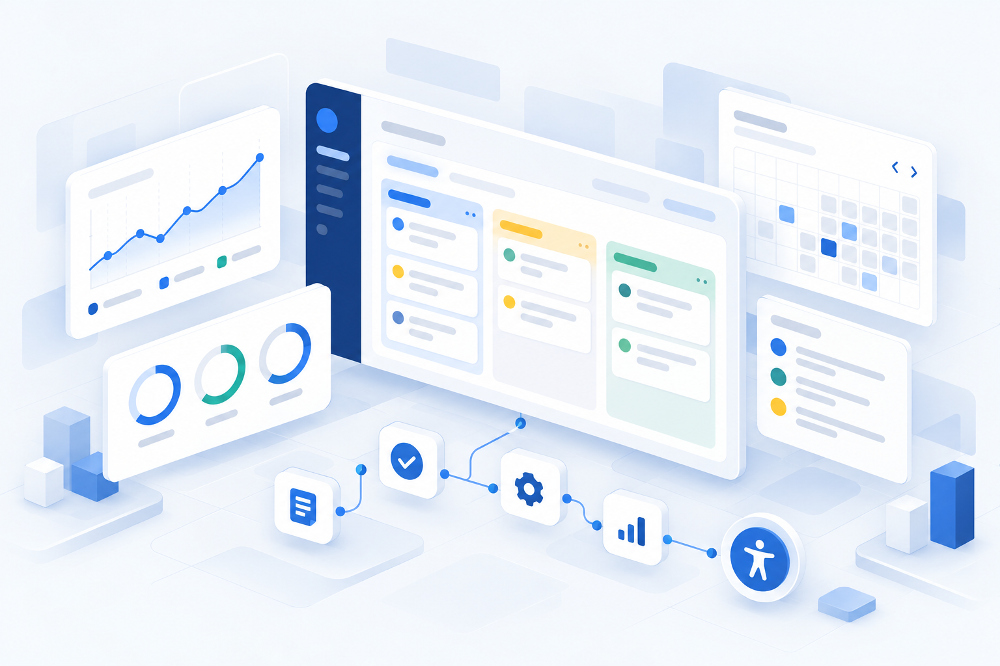

**Ivan Dika Pratama 252011082 · IT-Eksekutif**

Dosen Pengampu **Fadhli Almuiini Ahda, S.Kom., M.Kom.**

Rekayasa Perangkat Lunak · MKW TI_RPL.24

Program Studi Teknik Informatika **Institut Teknologi dan Bisnis Asia Malang** Semester Ganjil 2026/2027

12 Oktober 2026

[github.com/Ivan-Dika/RPL-Portofolio-252011082](https://github.com/Ivan-Dika/RPL-Portofolio-252011082)

## Daftar Isi

- [1. Identitas](#1-identitas)
- [2. Profil sistem dan alur pengguna](#2-profil-sistem-dan-alur-pengguna)
  - [2.1 Profil dan stakeholder sistem](#21-profil-dan-stakeholder-sistem)
  - [2.2 Menu beranda dan fungsi orientasi](#22-menu-beranda-dan-fungsi-orientasi)
  - [2.3 Menu project dan dukungan engineering](#23-menu-project-dan-dukungan-engineering)
  - [2.4 Menu tugas dan ticketing](#24-menu-tugas-dan-ticketing)
  - [2.5 Alur login dan otorisasi](#25-alur-login-dan-otorisasi)
  - [2.6 Alur CRUD Dailylog secara rinci](#26-alur-crud-dailylog-secara-rinci)
  - [2.7 Hasil uji dan keadaan akhir](#27-hasil-uji-dan-keadaan-akhir)
  - [2.8 Integrasi Notion dan batas interpretasi](#28-integrasi-notion-dan-batas-interpretasi)
- [3. Tabel empat sudut pandang](#3-tabel-empat-sudut-pandang)
  - [3.1 People Product Process Quality](#31-people-product-process-quality)
  - [3.2 Keunggulan aksesibilitas dan kualitas interaksi](#32-keunggulan-aksesibilitas-dan-kualitas-interaksi)
- [4. Tabel gejala software crisis](#4-tabel-gejala-software-crisis)
  - [4.1 Analisis indikator risiko kualitas](#41-analisis-indikator-risiko-kualitas)
- [5. Problem statement dan ide perbaikan](#5-problem-statement-dan-ide-perbaikan)
  - [5.1 Fokus perbaikan](#51-fokus-perbaikan)
  - [5.2 Problem statement](#52-problem-statement)
- [6. Link repository dan ringkasan isi](#6-link-repository-dan-ringkasan-isi)
- [7. Catatan keputusan dan penggunaan AI](#7-catatan-keputusan-dan-penggunaan-ai)
  - [7.1 Keputusan dan koreksi analisis](#71-keputusan-dan-koreksi-analisis)
  - [7.2 Alat tujuan dan verifikasi](#72-alat-tujuan-dan-verifikasi)
  - [7.3 Sumber dan ruang lingkup kajian](#73-sumber-dan-ruang-lingkup-kajian)
- [8. Lampiran screenshot](#8-lampiran-screenshot)

Laporan ini membedah **Project Sekawan** dari perspektif **Dev Team** melalui empat sudut pandang: **People, Product, Process, dan Quality**. Kajian mencakup fungsi menu, autentikasi, pengelolaan Dailylog, integrasi sumber data, serta evaluasi kualitas. Metode yang digunakan adalah observasi antarmuka dan pengujian CRUD dengan izin pengguna pada 12 Oktober 2026.

## 1. Identitas

| **Informasi** | **Keterangan** |
|---|---|
| Nama | Ivan Dika Pratama |
| NIM | 252011082 |
| Kelas | IT - Eksekutif |
| Mata kuliah | Rekayasa Perangkat Lunak, MKW TI_RPL.24 |
| Dosen | Fadhli Almuiini Ahda, S.Kom., M.Kom. |
| GitHub | [https://github.com/Ivan-Dika](https://github.com/Ivan-Dika) |
| Alamat Repository | [https://github.com/Ivan-Dika/RPL-Portofolio-252011082](https://github.com/Ivan-Dika/RPL-Portofolio-252011082) |
| Status Repository | **Public** |
| Tanggal Pengamatan dan Uji | **12 Oktober 2026** |

## 2. Profil sistem dan alur pengguna

### 2.1 Profil dan stakeholder sistem

- **Nama Sistem**: PS - Project Sekawan | Backlog
- **Alamat layanan**: [https://project.skwn.dev](https://project.skwn.dev)
- **Fungsi utama**: Manajemen project, dailylog, dan performa tim. Katalog menggambarkan pusat kendali delivery yang menghubungkan dashboard project, roadmap/recap dari **Notion**, pencatatan aktivitas, performance appraisal, ticketing, dan laporan eksekutif (Gambar [1](#gambar-1)).
Objek yang dibedah adalah aplikasi Project Sekawan/Backlog. Aplikasi lain dalam katalog internal hanya menjadi konteks navigasi, bukan objek review tambahan. Perspektif akun adalah **Dev Team**. **Menu Overview** memperlihatkan 40 menu total dan 12 dapat diakses pada sesi yang diamati (Gambar [2](#gambar-2)); jumlah tersebut bergantung pada hak akun. Pembatasan menu merupakan kontrol peran, bukan kesalahan hanya karena suatu menu terkunci.

| **Stakeholder** | **Kepentingan berdasarkan fungsi sistem** |
|---|---|
| Karyawan termasuk Dev Team | **Secara fungsional**: Pencatatan aktivitas, penelusuran tugas dan pemantauan progress. |
| Mentor | **Secara fungsional**: Pembinaan serta penelusuran catatan kinerja sesuai hak akses. |
| Project Admin | **Secara fungsional**: Koordinasi delivery dan monitoring pekerjaan sesuai hak akses. |
| Admin Aplikasi | **Secara fungsional**: Memiliki semua akses aplikasi dan mengatur master data. |

Pemetaan kepentingan di atas merupakan analisis fungsi dan pengalaman sesama tim di tempat kerja. **Dev Team** dipandang sebagai pelaksana pekerjaan, mentor sebagai pembina, dan Project Admin sebagai koordinator delivery. Tanggung jawab tersebut membedakan ketiga kelompok meskipun semuanya dapat berstatus karyawan. Frekuensi penggunaan dan pengalaman masing-masing kelompok tidak diukur dalam kajian ini.

### 2.2 Menu beranda dan fungsi orientasi

Portal ([/portal](https://project.skwn.dev/portal)) merupakan katalog aplikasi internal. Komponen opsi **Project Sekawan** menjelaskan fungsi dan sasaran pengguna serta menyediakan tautan **Buka**. Pada pengamatan awal tautan tersebut membuka **Dailylog** pada tab baru. **Pengumuman** ([/announcements](https://project.skwn.dev/announcements)) menyediakan informasi resmi; sesi menampilkan pengumuman fitur **Portal Project** dan **Tiket Portal**. Detail pengumuman tidak dianalisis sebagai bukti implementasi seluruh fitur.

Menu **Overview** ([/menu](https://project.skwn.dev/menu)) berfungsi sebagai peta navigasi dan transparansi hak akses. Kartu menampilkan nama menu, deskripsi ringkas, serta keadaan terkunci bila akun tidak berhak. **PA Monitor** bertuliskan fungsi **Monitoring QC** untuk **Project Admin** dan tidak diakses. **Penilaian Kinerja** ([/pa](https://project.skwn.dev/pa)) berbeda dari role **Project Admin**: halaman ini menampilkan filter tahun/bulan, ringkasan **sudah/belum dinilai**, tabel tim dengan **mentor/position/status**, dan area catatan penilaian (Gambar [13](#gambar-13)). Tidak ada penilaian personel yang dibuat, diubah, atau dibuka rinci.

**Dailylog** ([/dailylog](https://project.skwn.dev/dailylog)) adalah tempat mencatat aktivitas dan memantau progress. **Log Open** menyajikan daftar aktivitas beserta progress; penghitungan aktivitas terbuka dibedakan dari riwayat selesai. **Log Done** menyediakan riwayat dengan tanggal dan durasi serta filter tahun/bulan. Grafik Log per Minggu memberikan rekap jumlah aktivitas. Tombol Monitor Tim terlihat, tetapi isi monitoring orang lain tidak diperiksa. Form, grafik, dan struktur tabel diperlihatkan pada Gambar [3](#gambar-3)–[4](#gambar-4), [14](#gambar-14), [18](#gambar-18), dan [21](#gambar-21)–[22](#gambar-22).

### 2.3 Menu project dan dukungan engineering

**Dashboard Project** ([/project-dashboard](https://project.skwn.dev/project-dashboard)) memperlihatkan ringkasan jumlah proyek, fase development/maintenance/guarantee, overdue, dan rata-rata progress. Filter status, cluster, pencarian nama, serta tabel Project–Status–Cluster–Progress–Health–Team membantu pengguna beralih dari ringkasan portofolio ke daftar yang relevan (Gambar [8](#gambar-8)). Makna perhitungan Health dan rata-rata progress tidak ditelusuri sampai sumber/backend.

**Repo Analysis** ([/repo-analysis](https://project.skwn.dev/repo-analysis)) menghubungkan pemantauan repository dengan kualitas teknis. UI menyediakan pencarian nama/group/URL/branch, filter framework, group, status repo, scan terakhir, temuan, jadwal, dan urutan. Kolom SAST terakhir, SCA terakhir, branch scan, serta jadwal berikutnya menyediakan konteks pemeriksaan kode/dependensi (Gambar [9](#gambar-9)). Tombol Scan, Ubah, Nonaktifkan, Monitor, dan Pilih Repo terlihat; tidak dijalankan. Kehadiran menu analisis keamanan tidak membuktikan bahwa seluruh repository aman atau bahwa hasil scan benar tanpa pemeriksaan lanjutan.

**GitLab Pipelines** ([/gitlab-pipelines](https://project.skwn.dev/gitlab-pipelines)) merangkum jumlah pipeline, success rate, durasi rata-rata, failed, tren 7/14/30 hari, daftar repository, dan pipeline terbaru. Informasi terakhir sinkron membantu membedakan data monitoring dari keadaan real-time (Gambar [10](#gambar-10)). Tombol Sync tidak dijalankan; tidak ada build/deploy yang dipicu. Kegagalan pipeline dalam ringkasan tidak otomatis merupakan kegagalan aplikasi Backlog.

### 2.4 Menu tugas dan ticketing

Task Overview/My Tasks ([/my-tasks](https://project.skwn.dev/my-tasks)) menggabungkan pekerjaan dari Roadmap, **Tiket Portal**, dan Ticket. Filter sumber, status, Hanya terlambat, pencarian, dan pagination membantu **Dev Team** memusatkan perhatian. Tabel memuat source, project, task, status, progress/priority, deadline, dan peran (Gambar [5](#gambar-5)–[6](#gambar-6)). Filter Active terlihat bersama baris berlabel Cancel/Done. Ini perlu penjelasan definisi filter, bukan langsung disebut bug: status filter dan status sumber bisa memiliki aturan pemetaan berbeda.

**Ticket List** ([/tickets](https://project.skwn.dev/tickets)) mendukung antrean pekerjaan berbentuk tiket. Filter cari nomor/judul, status, role, priority, dan project menyediakan pemilahan; tabel menampilkan requester, assignee, deadline, dan created di samping identitas/status tiket. UI menawarkan status Open, Sedang Direview, In Progress, Menunggu Pelapor, Resolved, Closed, dan Cancelled (Gambar [11](#gambar-11)). Daftar status tidak membuktikan semua transisi diperbolehkan untuk setiap role. Tombol Buat Ticket tidak digunakan.

**Tiket Portal** ([/portal-tickets](https://project.skwn.dev/portal-tickets)) menangani tiket dengan konteks portal, parent, PIC, sumber, serta status sinkronisasi. Pilihan sumber Klien/Internal/Notion dan sync Menunggu/Gagal/Terkirim memberikan keterlacakan integrasi. Pengelompokan Portal, Status, PIC, Parent, Tipe, dan Sumber membantu membaca antrean dari beberapa sudut (Gambar [12](#gambar-12)). Tidak ada tiket atau sinkronisasi yang dibuat/diubah. **Ticket Dashboard** ([/ticket-dashboard](https://project.skwn.dev/ticket-dashboard)) merangkum active tickets/status distribution per role dan indikator overdue, unassigned lebih dari **24 jam**, serta menunggu pelapor lebih dari **48 jam**. Angka backlog/overdue menunjukkan keadaan operasional; bukan sendirinya bukti error perangkat lunak.

### 2.5 Alur login dan otorisasi

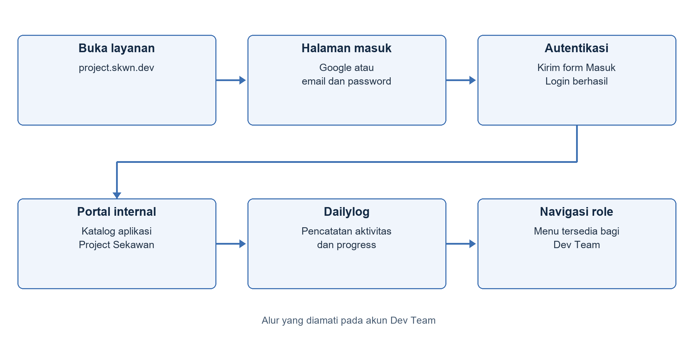

**Diagram 1. Alur login dan navigasi Dev Team**

- Pengguna membuka domain layanan; bila belum login, halaman [/login](https://project.skwn.dev/login) ditampilkan.
- Halaman menyediakan Masuk dengan Google atau opsi email dan password. Pengujian awal memakai email/password yang secara spesifik diizinkan pengguna.
- Pengguna mengirim form Masuk; UI menampilkan keadaan Memproses lalu login berhasil menuju [/portal](https://project.skwn.dev/portal).
- Pengguna memilih **Project Sekawan** dan masuk ke [/dailylog](https://project.skwn.dev/dailylog), kemudian dapat berpindah melalui sidebar, **Menu Overview**, atau Cari menu dengan petunjuk Ctrl K.
- Akun memiliki role **Dev Team**; menu yang tidak diizinkan ditampilkan terkunci. Tidak ada percobaan mengganti peran atau melewati kontrol tersebut.
Login berhasil diamati. Skenario password salah, pemulihan password, Google OAuth, logout, durasi sesi, dan keamanan backend tidak diuji. Alur lengkap ditunjukkan pada [Diagram 1](#diagram-1).

### 2.6 Alur CRUD Dailylog secara rinci

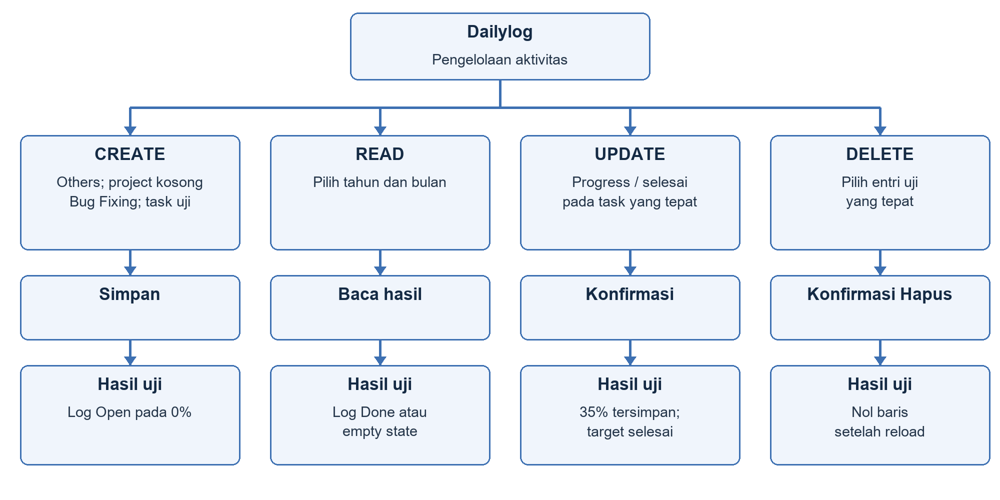

**Diagram 2. Alur CRUD Dailylog dan hasil pengujian**

- **Create**:
  - pilih jenis aktivitas. Roadmap menampilkan Roadmap (Detail) dan meminta pemilihan project terlebih dahulu untuk detail. Bug Fix menampilkan Test Case dengan konteks project. Others menampilkan Task Type dan Task; pilihan ini digunakan dalam uji karena input pengguna meminta project kosong dan Task Type Bug Fixing. Jenis Bug Fix dan Task Type Bug Fixing adalah dua kontrol berbeda, sehingga tidak boleh dianggap identik.
  - Project dibiarkan kosong, Task Type dipilih Bug Fixing, lalu Task diisi [Low] - Add Manbook ANTAM. Tombol Simpan **Dailylog** aktif dan diklik. Entri muncul satu kali di **Log Open** dengan tanggal 12 Oktober 2026 dan progress 0% (Gambar [15](#gambar-15)). Hasil ini membuktikan project kosong diterima untuk kombinasi input tersebut; tidak membuktikan project opsional pada jenis Roadmap/Bug Fix. Form kosong terlihat memiliki tombol simpan nonaktif pada sesi awal.
- **Read**
  - pengguna membaca **Log Open** untuk progress berjalan, membaca grafik mingguan, dan memilih tahun/bulan pada **Log Done**. Uji memilih September 2026 menghasilkan URL [/dailylog?bulan=9&tahun=2026](https://project.skwn.dev/dailylog?bulan=9&tahun=2026) dan pesan “Belum ada log selesai di periode ini” disertai saran memilih bulan lain (Gambar [18](#gambar-18)). Pesan **empty state** memberi penjelasan, bukan error. Filter kemudian dikembalikan ke Oktober 2026.
- **Update progress**
  - pengguna memilih tombol Ubah progress pada baris yang tepat. Dialog menampilkan Progress (%) berupa input angka dengan batas UI 0 sampai 100 serta Batal/Simpan (Gambar [14](#gambar-14)). Pengujian mengubah task migrasi yang ditentukan pengguna dari 0% menjadi 35%, menyimpan, lalu memuat ulang halaman. Nilai 35% tetap terlihat (Gambar [16](#gambar-16)). Penolakan angka di luar rentang serta validasi server belum diuji.
- **Update selesai:**
  - pengguna memilih Tandai selesai, lalu dialog aplikasi meminta konfirmasi “Tandai dailylog ini selesai?” dengan nama task, Batal, dan Tandai selesai. Task getter riwayat pegawai yang diizinkan diselesaikan setelah konfirmasi. Pemeriksaan ulang menunjukkan progress 100% pada daftar awal dan baris di **Log Done** dengan durasi 7j 32m (Gambar [20](#gambar-20)). Karena baris 100% masih dapat terlihat di daftar awal, perpindahan ke Log Done tidak berarti baris tersebut pasti langsung hilang dari seluruh tampilan. Durasi ditampilkan sistem; cara penghitungannya tidak diasumsikan sama dengan lama pengujian.
- **Delete:**
  - pengguna memilih Hapus pada task yang tepat, meninjau dialog “Hapus dailylog ini?” beserta nama task, lalu mengonfirmasi Hapus atau membatalkan. Hanya entri uji yang baru dibuat dihapus setelah konfirmasi eksplisit pengguna. Setelah reload, pencarian baris exact task tersebut menghasilkan nol baris, sedangkan task migrasi tetap 35% dan task selesai tercatat. Metode soft delete/permanent delete dan pemulihan tidak diketahui; **dialog konfirmasi** adalah pengaman yang terlihat.

### 2.7 Hasil uji dan keadaan akhir

| **Operasi** | **Input atau sasaran** | **Hasil yang diverifikasi** |
|---|---|---|
| Create | Others; project kosong; Bug Fixing; task uji | Satu entri baru muncul pada Log Open, progress 0%; Gambar [15](#gambar-15) |
| Read | Log Done September 2026 | Empty state sesuai periode dan URL filter; Gambar [18](#gambar-18); kembali Oktober |
| Update progress | Task migrasi yang ditentukan pengguna | 0% menjadi 35%, bertahan setelah reload; Gambar [16](#gambar-16) |
| Update selesai | Task getter riwayat pegawai yang ditentukan pengguna | Konfirmasi diterima; progress 100% dan baris Log Done terlihat; Gambar [20](#gambar-20) |
| Delete | Hanya task [Low] - Add Manbook ANTAM | Nol baris setelah reload; entri uji tidak tersisa |

Pada percobaan awal, **dialog konfirmasi** selesai/hapus belum terbaca pada struktur halaman. Pemeriksaan visual menemukan dialog tersebut, dan operasi berhasil setelah tombol konfirmasi diklik. Kendala pengamatan ini bukan bukti bahwa fitur aplikasi rusak. Tidak ada aksi lain pada tiket, repository analysis, pipeline, penilaian, atau data pengguna lain.

### 2.8 Integrasi Notion dan batas interpretasi

Menurut penjelasan pengguna, **deadline kosong** disebabkan deadline belum diatur di **Notion** yang menjadi sumber sinkronisasi. Karena itu tampilan “—” adalah representasi ketiadaan tanggal pada sumber, bukan error yang terbukti, dan dikeluarkan dari klasifikasi gejala serta masalah utama analisis awal. Konfirmasi ini berasal dari pengguna, bukan dari akses langsung ke Notion atau pemeriksaan implementasi sync.

Peta data konseptualnya adalah Notion/sumber tugas → sinkronisasi → daftar project/task/tiket pada Backlog → pencatatan aktivitas **Dailylog** → rekap pekerjaan/penilaian. Ini model analisis berdasarkan katalog, pilihan sumber, dan penjelasan pengguna; bukan diagram arsitektur backend yang telah diverifikasi. Pemilik data perlu membedakan tanggal belum diisi, data belum tersinkron, dan tugas tanpa tenggat menurut aturan bisnis, tanpa memberi label error pada semua kondisi tersebut.

## 3. Tabel empat sudut pandang

### 3.1 People Product Process Quality

| **Perspektif** | **Temuan dan Keunggulan** | **Analisis serta Batas** | **Bukti** |
|---|---|---|---|
| People | Role Dev Team dan hak menu terlihat; menu penilaian mengaitkan tim, mentor, periode; profil aksesibilitas beragam tersedia | Sistem mendukung pembagian tugas dan kebutuhan akses yang berbeda. Kepentingan stakeholder aktual belum diwawancarai; efektivitas profil aksesibilitas belum diuji dengan penggunanya | Gambar [2](#gambar-2), [7](#gambar-7), [13](#gambar-13) |
| Product | Dailylog, My Tasks, project dashboard, ticketing, repo analysis, pipeline dan penilaian saling melengkapi | Nilai utama secara analitis ialah satu pusat pencatatan/monitoring delivery. Fitur terlihat bukan berarti seluruh integrasi, perhitungan KPI, dan kualitas scan sudah tervalidasi | Gambar [3](#gambar-3), [5](#gambar-5), [8](#gambar-8)–[13](#gambar-13) |
| Process | Login dan navigasi berhasil; create/read/update/delete Dailylog diuji sesuai izin; dialog konfirmasi melindungi selesai/hapus | Alur mempunyai tahap input, pembacaan, koreksi progress, konfirmasi, dan pemeriksaan ulang. Batas jenis input perlu diperhatikan; status dari beberapa sumber membutuhkan definisi konsisten | Gambar [1](#gambar-1), [14](#gambar-14)–[20](#gambar-20) |
| Quality | Filter, empty state yang jelas, input progress 0–100, aksesibilitas, indikator sync dan jadwal scan tersedia | Ada dukungan usability dan keterlacakan. Aspek perbaikan terletak pada konteks minggu, terminologi status, dan kepadatan tabel. Keamanan server, WCAG, stabilitas jangka panjang, serta kecepatan terukur belum diuji | Gambar [4](#gambar-4)–[7](#gambar-7), [9](#gambar-9)–[10](#gambar-10), [14](#gambar-14), [18](#gambar-18), [21](#gambar-21)–[22](#gambar-22) |

### 3.2 Keunggulan aksesibilitas dan kualitas interaksi

Panel aksesibilitas menyediakan profil gangguan motorik, tunanetra, buta warna, disleksia, penglihatan rendah, kognitif/belajar, epilepsi/kejang, dan ADHD. Kategori penyesuaian Teks, Warna, Navigasi, Konten, Animasi, serta Pintasan Keyboard terlihat, bersama Reset Semua (Gambar [7](#gambar-7)). Ini keunggulan karena aplikasi memberi ruang penyesuaian pengalaman bagi pengguna dengan kebutuhan berbeda. Pengujian hanya membuka/menutup panel; tidak mengubah profil atau mengklaim kepatuhan **WCAG**.

Keunggulan lain meliputi pencarian menu Ctrl K, pengelompokan menu, akses per role, filter lintas sumber, tanggal/durasi aktivitas, ringkasan project dan tiket, serta transparansi sinkronisasi pipeline. Empty state September memberi arahan tindakan, dan dialog selesai/hapus menyebut task yang akan diproses. Hal ini mengurangi risiko pengguna bertindak pada entri yang salah ketika konfirmasi dibaca dengan teliti.

## 4. Tabel gejala software crisis

### 4.1 Analisis indikator risiko kualitas

Pengujian **CRUD** berhasil dan tidak menjadi dasar untuk menyatakan aplikasi gagal. Tabel berikut mengevaluasi tiga indikator risiko kualitas yang berkaitan dengan konsistensi informasi, keterbacaan, dan efisiensi interaksi. Dampak pada pengguna belum diukur, sehingga indikator ini tidak diklasifikasikan sebagai tiga kegagalan operasional terverifikasi. Deadline kosong yang mengikuti data **Notion**, menu terkunci sesuai role, **empty state**, dan **dialog konfirmasi** dikeluarkan dari klasifikasi kesalahan.

| **Indikator risiko** | **Bukti dan Batas** | **Dugaan Penyebab** | **Respons RPL yang tepat** |
|---|---|---|---|
| Pengguna perlu menafsirkan arti Active dibanding status sumber | Active terlihat bersama Cancel/Done pada My Tasks. Belum ada konfirmasi definisi Active atau dampak pada keputusan pengguna; bukan langsung bug | Filter mungkin memakai dimensi/kumpulan status berbeda dari label sumber Notion | Dokumentasikan definisi filter, pemetaan status dan acceptance criteria; uji konsistensi dengan aturan bisnis; tampilkan bantuan konteks |
| Periode minggu berpotensi sulit dipahami tanpa konteks tanggal yang eksplisit | Area grafik memakai Week 1–Week 5, Gambar [4](#gambar-4). Tanggal awal/akhir minggu belum terlihat di area itu; konteks lain mungkin tersedia | Label ringkas mengandalkan konteks filter/periode yang tidak dekat dengan grafik | Tampilkan judul periode dan rentang tanggal minggu jika pengguna memang kesulitan; lakukan uji pemahaman sebelum menambah elemen |
| Kepadatan tabel menambah kebutuhan gulir horizontal untuk melihat seluruh kolom | Pada viewport desktop sesi uji, container tabel Dailylog sekitar 829 px sedangkan lebar tabel sekitar 876 px; scrollbar terlihat, Gambar [21](#gambar-21)–[22](#gambar-22). Dampak kesalahan/kelambatan belum diukur | Banyak kolom dan judul tugas panjang berbagi ruang dengan form di sisi kanan | Prioritaskan kolom, pertimbangkan kolom aksi tetap terlihat, penyesuaian layout atau detail expandable; uji dengan tugas panjang dan layar yang lazim |

Respons tersebut adalah usulan requirement/usability, bukan diagnosis kode/database. Evaluasi lanjutan dapat meminta **Dev Team** menjelaskan arti Active, menyebut rentang satu minggu pada grafik, dan menyelesaikan tugas pemantauan pada tabel tanpa panduan. Catat waktu, kesalahan, dan komentar pengguna bila pengujian tersebut nanti dilakukan. Bug aplikasi klien yang muncul dalam judul task tidak digunakan sebagai bukti bug Backlog.

## 5. Problem statement dan ide perbaikan

### 5.1 Fokus perbaikan

Fokus perbaikan adalah kejelasan konteks status lintas sumber dalam **My Tasks**. Pilihan ini didasarkan pada pengamatan bahwa **filter Active** dapat tampil bersama label Done atau Cancel. Deadline kosong tidak dipilih sebagai masalah karena pengguna menjelaskan bahwa tanggal belum diatur pada sumber **Notion**. Kajian memprioritaskan penjelasan semantik dan konsistensi aturan tanpa mengubah sumber data secara sepihak.

### 5.2 Problem statement

**Dev Team** perlu menafsirkan hubungan antara **filter Active** dan label status sumber seperti Done atau Cancel saat memantau **My Tasks**, sehingga konteks pekerjaan yang perlu ditindaklanjuti harus dijelaskan secara konsisten. Kebutuhan kejelasan informasi ini didasarkan pada keadaan filter dan tabel dalam Gambar [5](#gambar-5)–[6](#gambar-6); kajian tidak mengasumsikan bahwa perbedaan label tersebut merupakan kesalahan pemetaan status.

Problem statement berfokus pada kebutuhan kejelasan informasi. Rekomendasi berikut tidak mensyaratkan perubahan logika filter apabila aturan yang berlaku sudah sesuai; penjelasan aturan dan pengujian konsistensi menjadi prioritas.

| **Prioritas** | **Ide perbaikan** | **Alasan dan kriteria penerimaan usulan** |
|---|---|---|
| 1 | Jelaskan definisi Active/Completed dan hubungannya dengan status sumber di dekat filter | Pengguna dapat menjelaskan apa yang termasuk Active dan mengapa Done/Cancel tertentu dapat muncul, jika itu sesuai aturan; tidak perlu mengubah data Notion |
| 2 | Buat tabel pemetaan status sumber dan pengujian konsistensi berdasarkan aturan bisnis | Setiap status memiliki perilaku filter yang terdokumentasi; bila Cancel/Done sengaja termasuk, alasannya jelas; bila tidak, ketidaksesuaian dapat direproduksi dan diperbaiki |
| 3 | Sediakan pilihan fokus pekerjaan dan preferensi filter yang sesuai kebiasaan Dev Team | Setelah kebutuhan dikonfirmasi, pengguna dapat melihat pekerjaan yang perlu tindakan tanpa kehilangan akses riwayat; manfaat diuji, bukan menambah default secara sepihak |

Peluang sekunder adalah memperjelas periode grafik dan mengurangi beban gulir tabel. Keunggulan aksesibilitas, pengaman konfirmasi, dan sinkronisasi sumber tetap dipertahankan. Tidak ada perbaikan aplikasi yang diimplementasikan pada tugas ini.

## 6. Link repository dan ringkasan isi

Alamat repository (**public**): [https://github.com/Ivan-Dika/RPL-Portofolio-252011082](https://github.com/Ivan-Dika/RPL-Portofolio-252011082). Repository berisi [README.md](https://github.com/Ivan-Dika/RPL-Portofolio-252011082/blob/main/README.md) (ringkasan tugas), [LICENSE](https://github.com/Ivan-Dika/RPL-Portofolio-252011082/blob/main/LICENSE) (**MIT**), [docs/KOMITMEN-KERJA.md](https://github.com/Ivan-Dika/RPL-Portofolio-252011082/blob/main/docs/KOMITMEN-KERJA.md), [docs/PENGGUNAAN-AI.md](https://github.com/Ivan-Dika/RPL-Portofolio-252011082/blob/main/docs/PENGGUNAAN-AI.md), laporan ini dalam format DOCX dan Markdown, serta folder [assets/](https://github.com/Ivan-Dika/RPL-Portofolio-252011082/tree/main/assets) yang memuat screenshot bernomor.

Lisensi **MIT** mengikuti keputusan penulis sebagai pemilik copyright. Lisensi tidak otomatis mencakup merek, UI, data perusahaan/klien, dan dokumen dosen. NIM boleh tampil sesuai izin penulis, tetapi izin tersebut tidak berlaku untuk data privat lain. Screenshot pada laporan telah dipotong untuk mengeluarkan identitas dan data klien.

Pengumpulan dilakukan melalui LMS berupa satu file PDF laporan bernama **SS1_252011082_Ivan Dika Pratama.pdf** dan link repository. Link repository dicantumkan pada halaman pertama laporan dan pada kolom komentar LMS.

## 7. Catatan keputusan dan penggunaan AI

### 7.1 Keputusan dan koreksi analisis

- Objek dipilih pengguna: Project Sekawan/Backlog; cakupan diperluas dari Overview menjadi 12 menu yang tersedia bagi **Dev Team**.
- Identitas laporan menggunakan NIM **252011082**, nama **Ivan Dika Pratama**, kelas **IT-Eksekutif** dan dosen sesuai data yang diberikan.
- Kepentingan stakeholder dipisahkan antara hasil wawancara yang belum tersedia dan pemetaan fungsional yang digunakan dalam analisis.
- **CRUD** hanya dijalankan pada data/tindakan yang secara spesifik diizinkan. Entri uji dibuat dan dihapus; dua task yang ditentukan pengguna diubah sesuai instruksi.
- Kendala konfirmasi awal diselesaikan melalui inspeksi visual. Operasi selesai/hapus berhasil setelah konfirmasi; tidak dicatat sebagai error perangkat lunak.
- A3 mengklasifikasikan indikator risiko kualitas dan tidak mengklaim tiga kegagalan terverifikasi. Rubrik berbobot dan slide acuan tidak tersedia dalam sumber yang digunakan.
- Gambar dipotong untuk mengeluarkan identitas dan detail privat lain. Judul task uji/target yang dicantumkan terbatas pada yang diberikan pengguna.

### 7.2 Alat tujuan dan verifikasi

Alat: 

- **Claude Code**, pembuatan struktur GIT dan to do list proses analisa beserta review struktur dokumen
- **Codex/ChatGPT**, pengolahan dokumen lokal, menyusun struktur portofolio lokal, serta menyusun diagram pada DOCX serta generate gambar sampul. Tidak ada **Codex CLI/ChatGPT** lokal tambahan, instalasi, atau konektor eksternal tambahan yang digunakan.
Bagian analisis dan penulisan berasal dari analisa manual dan pembiasaan penulis. Verifikasi dilakukan dengan membandingkan UI, screenshot, dan keadaan setelah reload, serta memasukkan koreksi pengguna. Cakupan observasi, analisis, dan pengujian dilaporkan pada dokumen ini. Screenshot pada lampiran dipotong dan diblur untuk mengeluarkan identitas dan data klien.

Dokumen disusun dengan pemeriksaan isi, struktur, identitas, rujukan gambar, serta keberadaan lampiran. Screenshot diperiksa satu per satu. Dokumen tugas referensi tidak diubah atau disalin ke repository.

Ilustrasi sampul dibuat menggunakan ImageGen berdasarkan dua screenshot aplikasi yang telah dipotong untuk privasi. Ilustrasi bersifat dekoratif, bukan bukti antarmuka. Diagram alur merupakan visualisasi penulis berdasarkan proses yang diamati.

### 7.3 Sumber dan ruang lingkup kajian

Sumber: lembar tugas RPL Pertemuan 1; halaman [/portal](https://project.skwn.dev/portal), [/announcements](https://project.skwn.dev/announcements), [/menu](https://project.skwn.dev/menu), [/dailylog](https://project.skwn.dev/dailylog), [/pa](https://project.skwn.dev/pa), [/project-dashboard](https://project.skwn.dev/project-dashboard), [/repo-analysis](https://project.skwn.dev/repo-analysis), [/gitlab-pipelines](https://project.skwn.dev/gitlab-pipelines), [/my-tasks](https://project.skwn.dev/my-tasks), [/tickets](https://project.skwn.dev/tickets), [/portal-tickets](https://project.skwn.dev/portal-tickets), dan /ticket-dashboard pada project.skwn.dev; input/koreksi pengguna. Semua pengamatan UI pada 12 Oktober 2026. Repository bersifat **public** sehingga dapat diakses dosen.

Ruang lingkup tidak mencakup wawancara stakeholder, pengukuran dampak usability, audit backend, kepatuhan **WCAG**, publikasi repository, dan pengumpulan LMS. Keadaan akhir uji: entri uji tidak tersisa, migrasi 35%, task getter selesai tercatat, dan filter kembali Oktober 2026.

## 8. Lampiran screenshot

Lampiran **DOCX** memuat gambar bernomor dan bertanggal 12 Oktober 2026. Bukti berasal dari pengambilan screenshoot pada browse. Cuplikan mempertahankan piksel UI yang ditampilkan; tidak ada antarmuka dibuat ulang oleh image generation. Pemotongan mengeluarkan identitas akun, klien/project, dan isi tugas yang tidak diperlukan. Gambar pada keadaan awal dan setelah **CRUD** tidak dianggap satu keadaan yang sama.

Gambar [1](#gambar-1)–[6](#gambar-6): katalog, menu, form, grafik, filter, dan kolom tugas. Gambar [7](#gambar-7)–[14](#gambar-14): aksesibilitas, menu tambahan dan dialog progress. Gambar [15](#gambar-15)–[20](#gambar-20): bukti create, progress, konfirmasi awal, filter Log Done, ringkasan akhir, dan baris selesai. Gambar [21](#gambar-21)–[22](#gambar-22): header dan scrollbar tabel. Screenshot hanya membuktikan keadaan UI pada saat pengambilan, bukan seluruh kualitas aplikasi.

**Gambar 1. Katalog Project Sekawan**

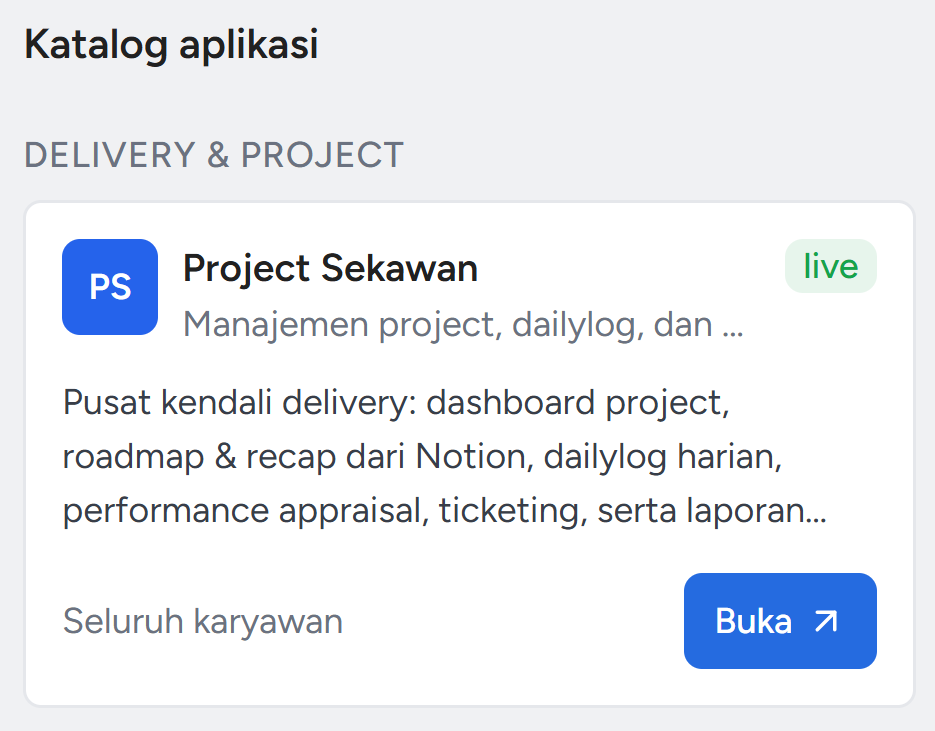

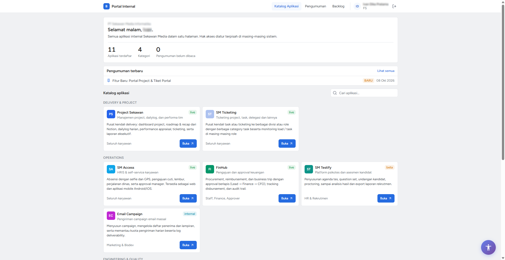

Tanggal: 12 Oktober 2026 · Sumber: [https://project.skwn.dev/portal](https://project.skwn.dev/portal)  
Nama, fungsi, sasaran pengguna, dan cakupan layanan.

**Gambar 2. Peta menu Dev Team**

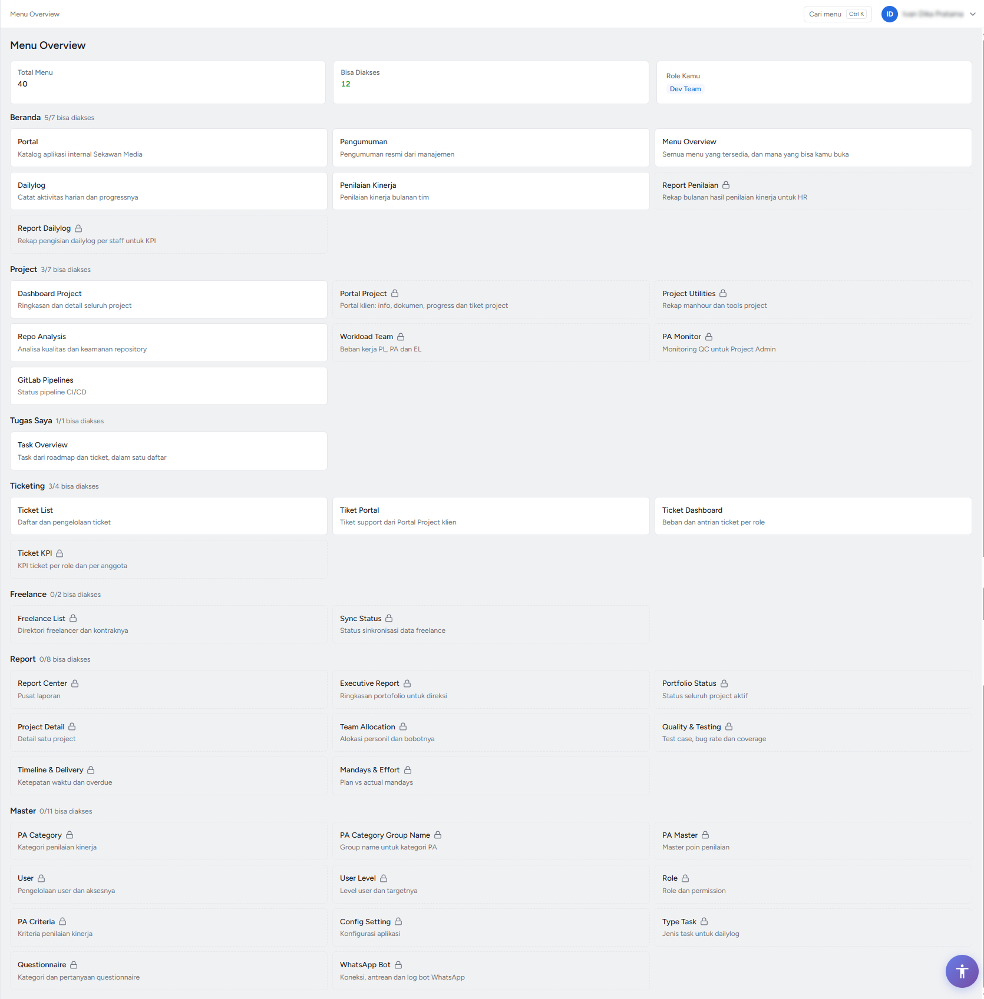

Tanggal: 12 Oktober 2026 · Sumber: [https://project.skwn.dev/menu](https://project.skwn.dev/menu)  
Ringkasan hak akses; menu terkunci tidak dianggap error.

**Gambar 3. Form Dailylog jenis Others**

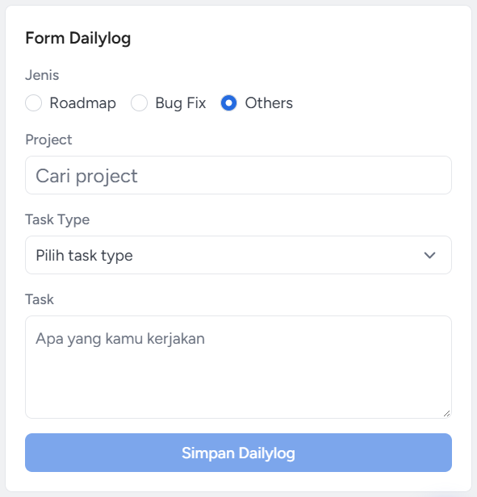

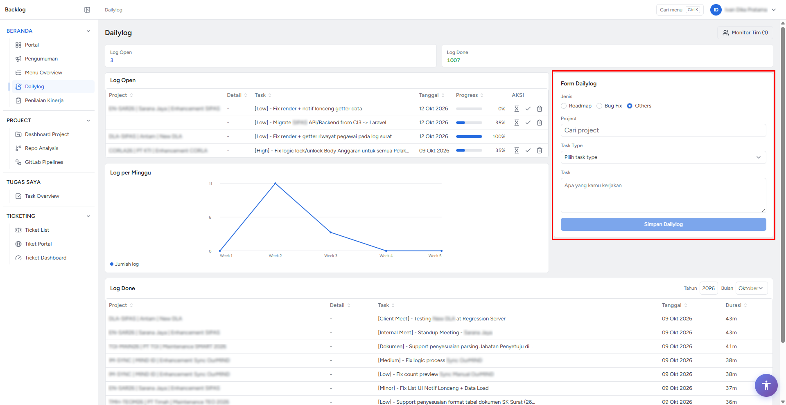

Tanggal: 12 Oktober 2026 · Sumber: [https://project.skwn.dev/dailylog](https://project.skwn.dev/dailylog)  
Jenis aktivitas, project, task type, dan task sebelum pengisian.

**Gambar 4. Grafik Log per Minggu**

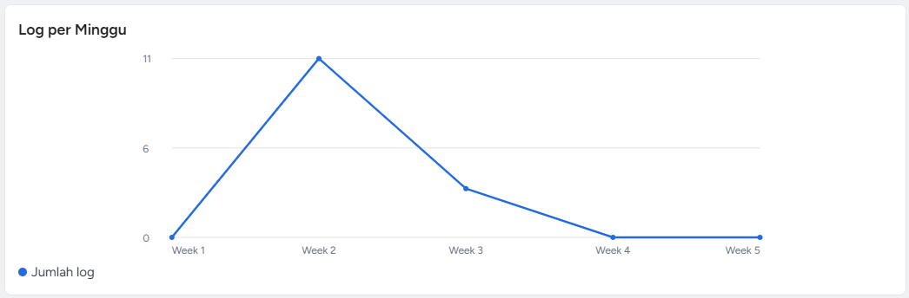

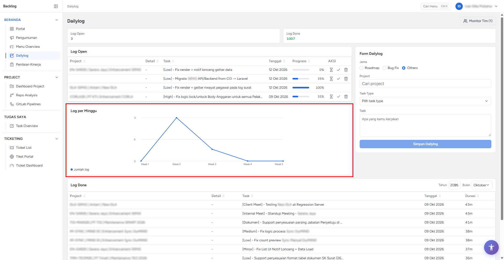

Tanggal: 12 Oktober 2026 · Sumber: [https://project.skwn.dev/dailylog](https://project.skwn.dev/dailylog)  
Keadaan awal sesi; Week 1–Week 5. Konteks di bagian lain belum dibuktikan tidak ada.

**Gambar 5. Filter sumber dan status My Tasks**

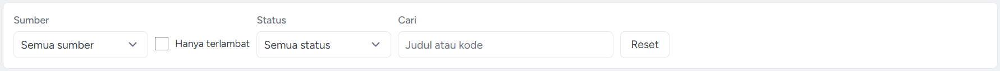

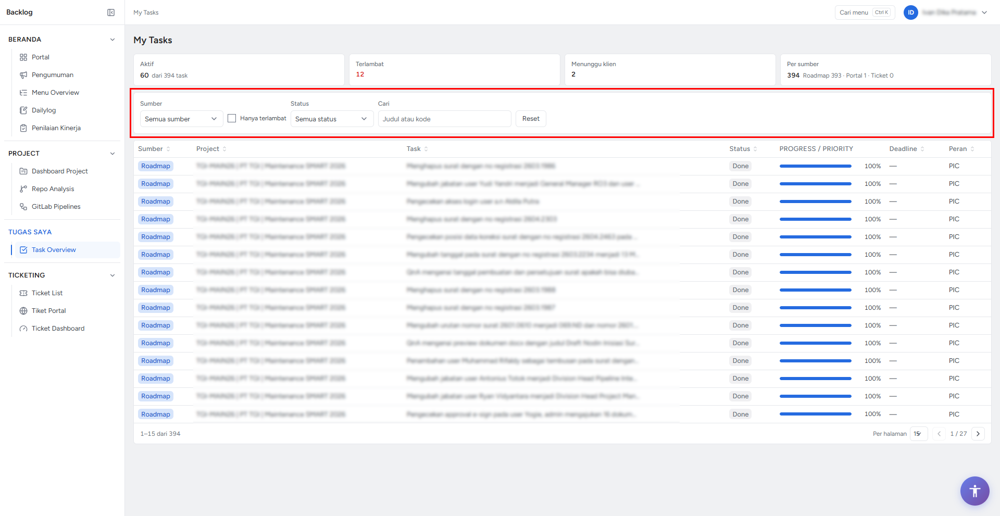

Tanggal: 12 Oktober 2026 · Sumber: [https://project.skwn.dev/my-tasks](https://project.skwn.dev/my-tasks)  
Keadaan filter Active, menjadi konteks Gambar [6](#gambar-6).

**Gambar 6. Status deadline dan peran tugas**

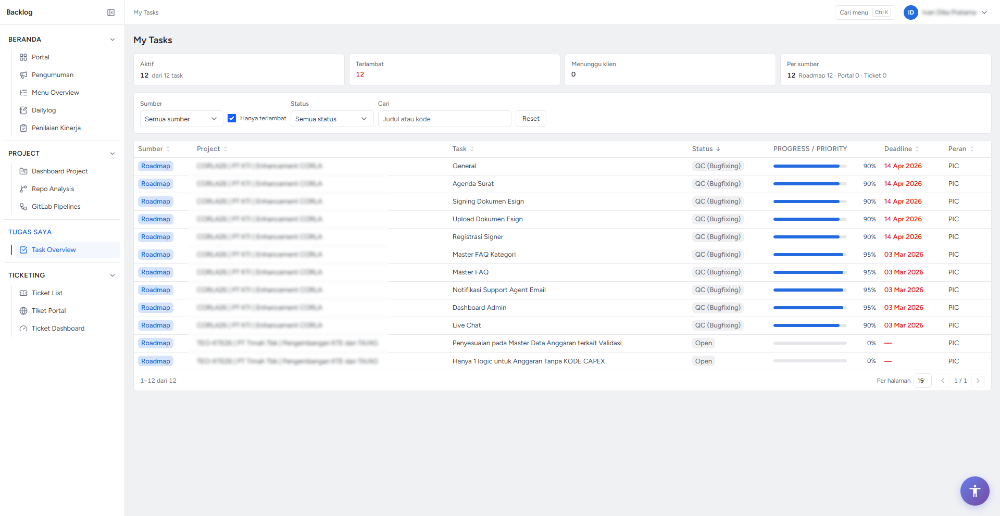

Tanggal: 12 Oktober 2026 · Sumber: [https://project.skwn.dev/my-tasks](https://project.skwn.dev/my-tasks)  
Deadline kosong diterangkan pengguna sebagai belum diatur di Notion, bukan error.

**Gambar 7. Panel aksesibilitas**

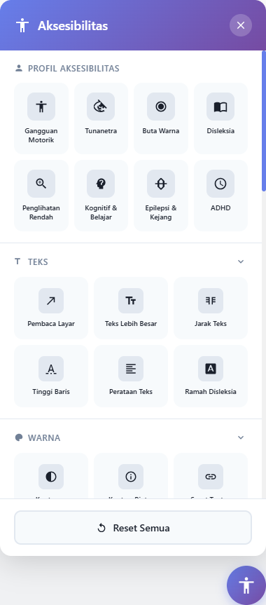

Tanggal: 12 Oktober 2026 · Sumber: [https://project.skwn.dev/gitlab-pipelines](https://project.skwn.dev/gitlab-pipelines)  
Profil kebutuhan pengguna dan kategori penyesuaian; efektivitas/WCAG belum diuji.

**Gambar 8. Dashboard Project**

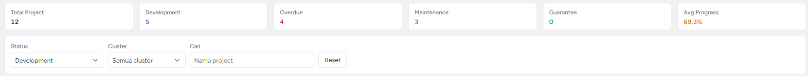

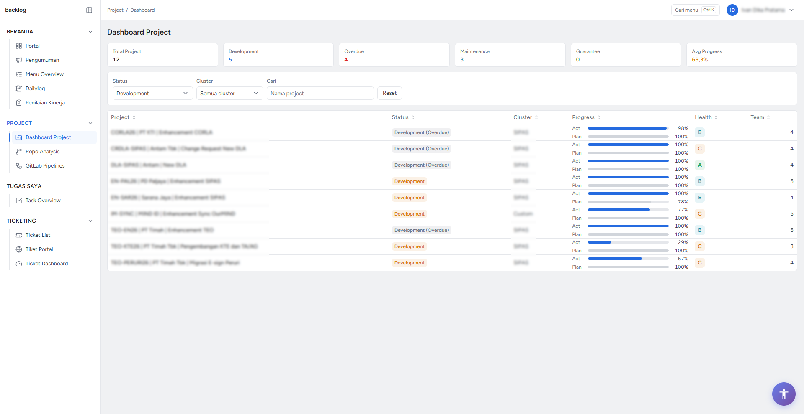

Tanggal: 12 Oktober 2026 · Sumber: [https://project.skwn.dev/project-dashboard](https://project.skwn.dev/project-dashboard)  
Ringkasan, filter, dan header tabel; nama project dikeluarkan.

**Gambar 9. Repo Analysis**

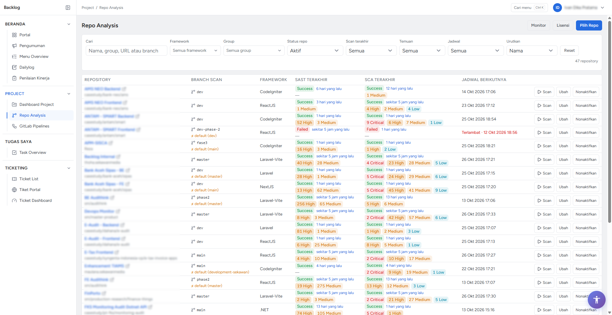

Tanggal: 12 Oktober 2026 · Sumber: [https://project.skwn.dev/repo-analysis](https://project.skwn.dev/repo-analysis)  
Filter, branch/scan SAST/SCA dan jadwal; tidak menjalankan scan atau perubahan repo.

**Gambar 10. GitLab Pipelines**

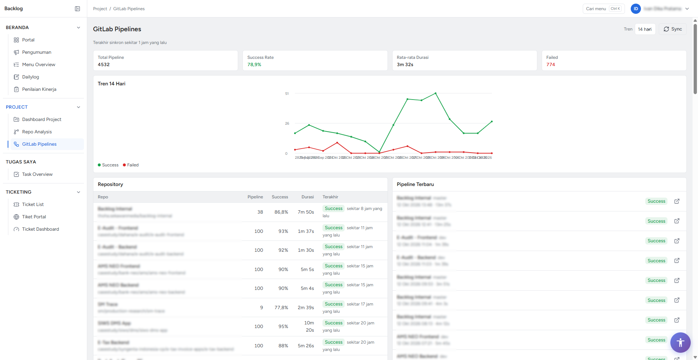

Tanggal: 12 Oktober 2026 · Sumber: [https://project.skwn.dev/gitlab-pipelines](https://project.skwn.dev/gitlab-pipelines)  
Ringkasan monitoring dan waktu sync; angka sesaat bukan bukti error Backlog.

**Gambar 11. Ticket List**

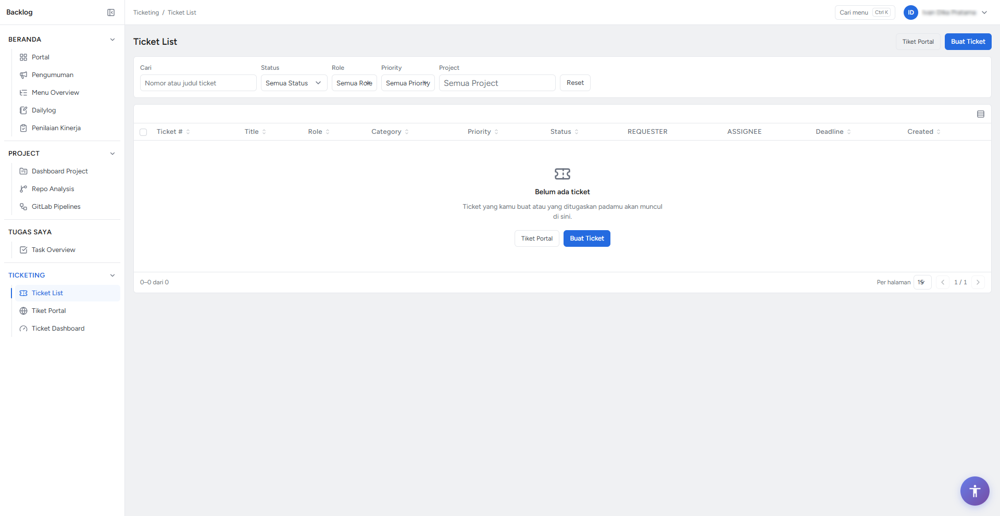

Tanggal: 12 Oktober 2026 · Sumber: [https://project.skwn.dev/tickets](https://project.skwn.dev/tickets)  
Filter antrean dan struktur kolom; tidak membuat atau mengubah tiket.

**Gambar 12. Tiket Portal**

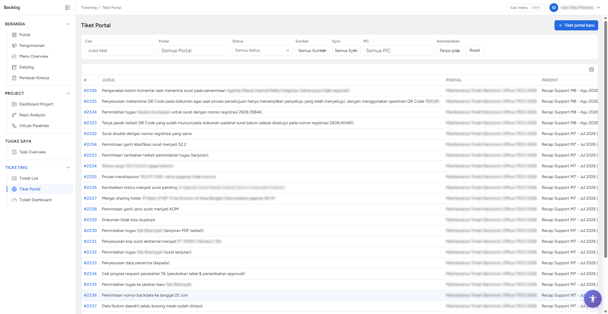

Tanggal: 12 Oktober 2026 · Sumber: [https://project.skwn.dev/portal-tickets](https://project.skwn.dev/portal-tickets)  
Filter sumber, sync, PIC dan pengelompokan; identitas/tiket privat dikeluarkan.

**Gambar 13. Penilaian Kinerja**

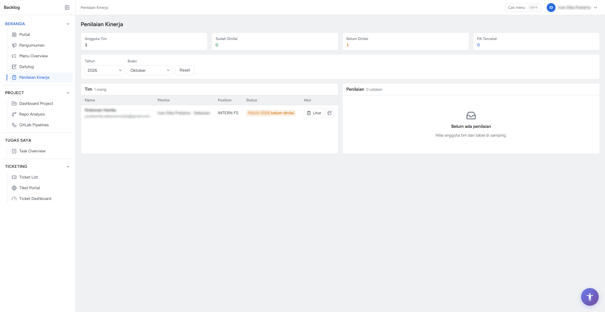

Tanggal: 12 Oktober 2026 · Sumber: [https://project.skwn.dev/pa](https://project.skwn.dev/pa)  
Ringkasan dan periode; tidak membuka atau mengubah penilaian individu.

**Gambar 14. Input perubahan progress**

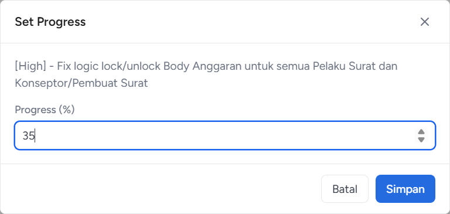

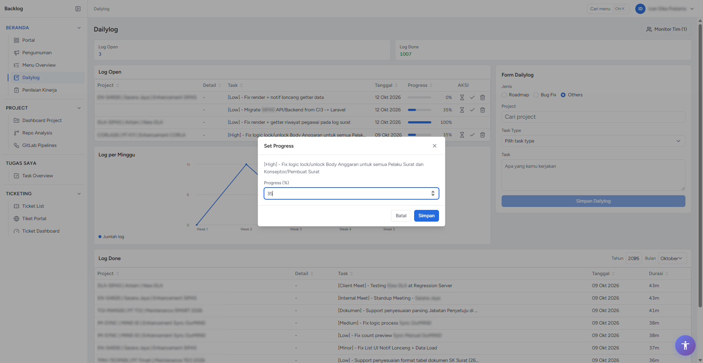

Tanggal: 12 Oktober 2026 · Sumber: [https://project.skwn.dev/dailylog](https://project.skwn.dev/dailylog)  
Kontrol angka dan tombol Batal/Simpan. Cuplikan tidak menampilkan nama task lain.

**Gambar 15. Entri uji setelah Create**

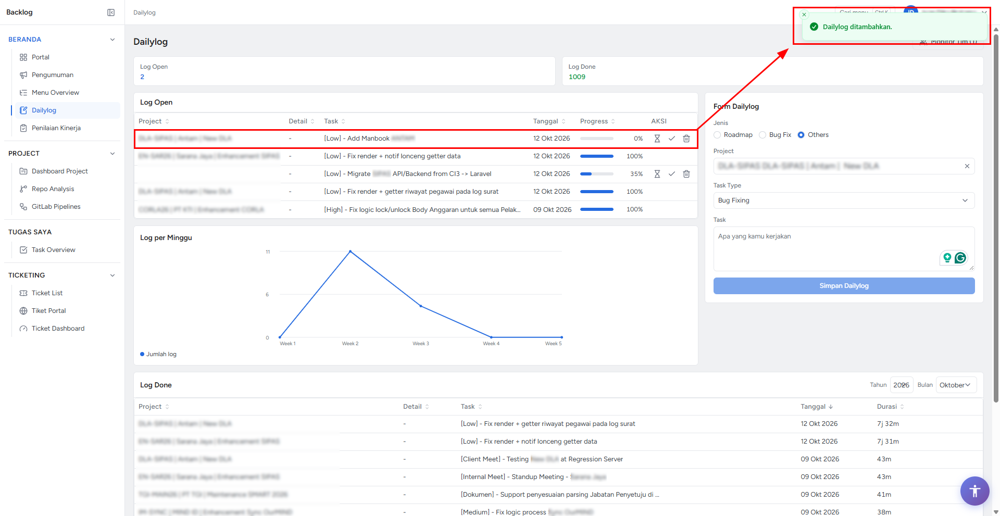

Tanggal: 12 Oktober 2026 · Sumber: [https://project.skwn.dev/dailylog](https://project.skwn.dev/dailylog)  
Task uji muncul pada 0%; ditangkap saat lapisan konfirmasi operasi berikutnya aktif. Entri kemudian berhasil dihapus.

**Gambar 16. Task migrasi pada 35 persen**

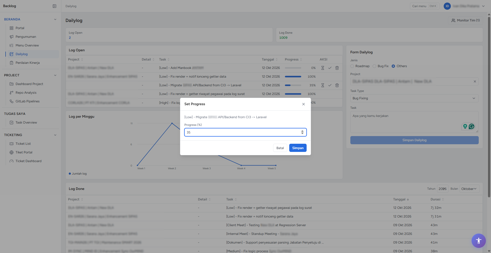

Tanggal: 12 Oktober 2026 · Sumber: [https://project.skwn.dev/dailylog](https://project.skwn.dev/dailylog)  
Nilai 35% terlihat; lapisan konfirmasi operasi lain membuat latar tampak redup. Nilai juga diverifikasi setelah reload.

**Gambar 17. Tahap konfirmasi selesai**

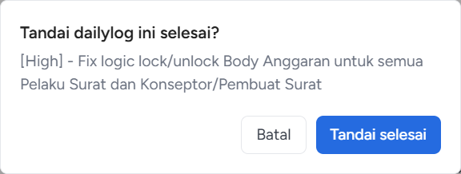

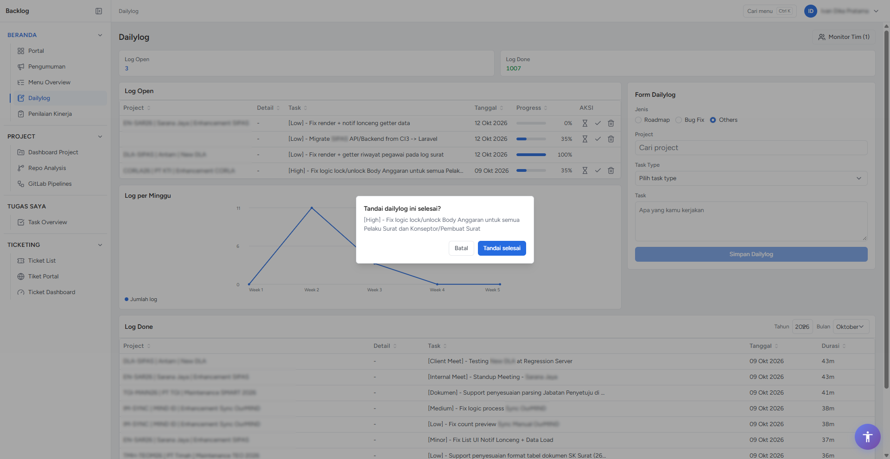

Tanggal: 12 Oktober 2026 · Sumber: [https://project.skwn.dev/dailylog](https://project.skwn.dev/dailylog)  
Cuplikan awal memperlihatkan permintaan konfirmasi; bukan hasil akhir atau kegagalan fitur. Konfirmasi kemudian diterima.

**Gambar 18. Filter Log Done September 2026**

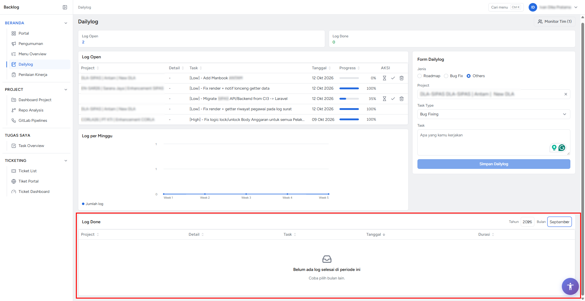

Tanggal: 12 Oktober 2026 · Sumber: [https://project.skwn.dev/dailylog?bulan=9&tahun=2026](https://project.skwn.dev/dailylog?bulan=9&tahun=2026)  
Empty state dan saran memilih bulan lain; filter dikembalikan ke Oktober.

**Gambar 19. Ringkasan sesudah CRUD**

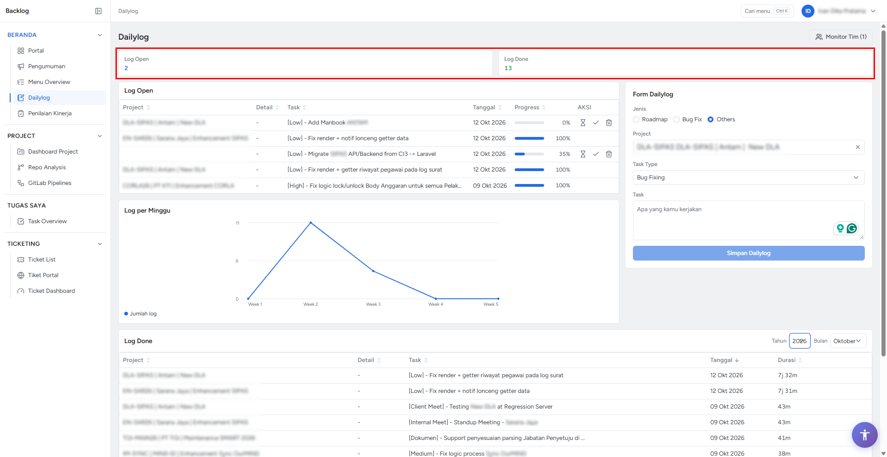

Tanggal: 12 Oktober 2026 · Sumber: [https://project.skwn.dev/dailylog?bulan=10&tahun=2026](https://project.skwn.dev/dailylog?bulan=10&tahun=2026)  
Ringkasan akhir. Keberhasilan delete juga diperiksa lewat nol baris exact task uji setelah reload.

**Gambar 20. Task yang selesai pada Log Done**

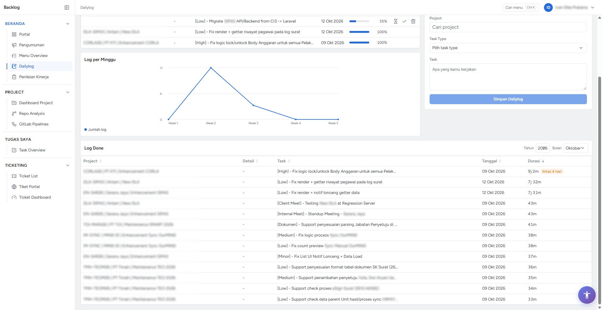

Tanggal: 12 Oktober 2026 · Sumber: [https://project.skwn.dev/dailylog?bulan=10&tahun=2026](https://project.skwn.dev/dailylog?bulan=10&tahun=2026)  
Task target tercatat dengan tanggal dan durasi; project/klien dikeluarkan. Durasi sistem bukan lama pengujian.

**Gambar 21. Header tabel Dailylog**

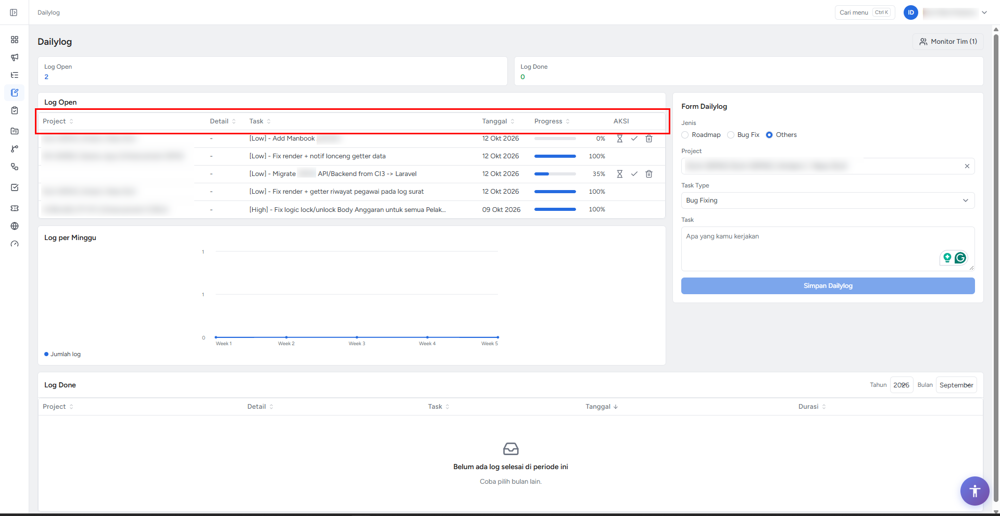

Tanggal: 12 Oktober 2026 · Sumber: [https://project.skwn.dev/dailylog](https://project.skwn.dev/dailylog)  
Kolom yang berbagi ruang dengan form; menunjukkan struktur, bukan data task privat.

**Gambar 22. Scrollbar horizontal Dailylog**

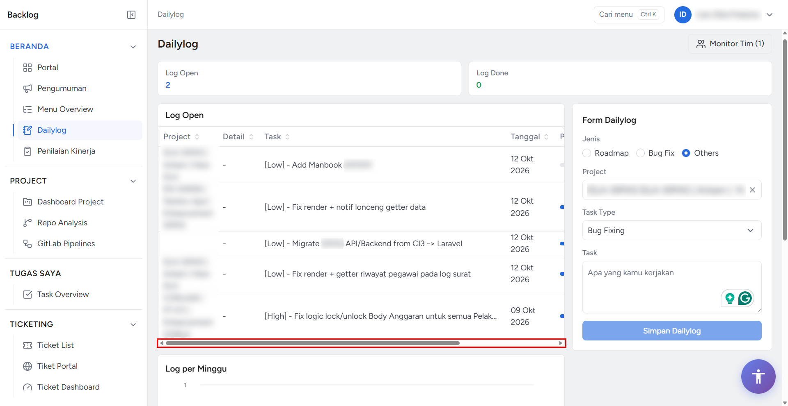

Tanggal: 12 Oktober 2026 · Sumber: [https://project.skwn.dev/dailylog](https://project.skwn.dev/dailylog)  
Kontrol gulir yang terlihat; dampak pada kecepatan/kesalahan pengguna belum diukur.
